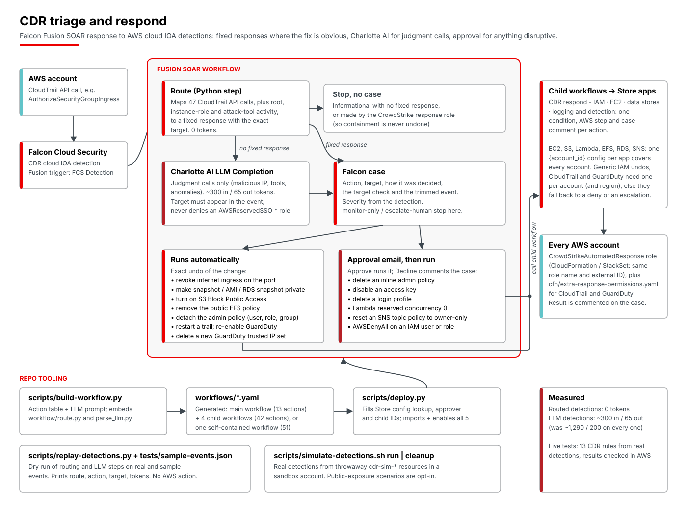

# CDR triage and respond with Falcon Fusion SOAR



A Falcon Fusion SOAR workflow that responds to AWS cloud detections (Falcon Cloud Security CDR, cloud IOA).

- **Most detections need no LLM.** A Python step reads the CloudTrail event. If the API call has one obvious fix (a security group opened, a snapshot made public, an admin policy attached), it picks that response and reads the exact target from the event.
- **Charlotte AI only handles judgment calls**, such as API calls from malicious IPs, attack-tool usage, or anomalies. It uses a short prompt and a trimmed event. Its target must appear verbatim in the event, or the detection is escalated.
- **Exact undos of exposure and policy changes run automatically.** Other containment needs an analyst to approve it by email. Every result is commented on a Falcon case.

```
FCS cloud IOA detection (AWS)
  → Route (Python): fixed response for this API call?  ── yes ─┐
        │ informational, or made by CrowdStrike's own response role → stop
        └ no → Charlotte AI LLM Completion (~300 tokens in / ~65 out)
               → check the target appears in the event, else escalate ─┤
  → Case (severity from the detection)                                ←┘
  → exact undo (auto set)      → run now                → child workflow → comment on the case
  → other containment          → approval email → Approve → child workflow → comment on the case
                                                → Decline → comment on the case
  → monitor-only / escalate-human → case only
```

## Responses

| Action | Triggered by (CloudTrail API call) | Runs | Approval |
|---|---|---|---|
| `sg-revoke-ingress` | `AuthorizeSecurityGroupIngress` from 0.0.0.0/0 or ::/0 | EC2: remove the internet ingress rule on that port | Auto |
| `remove-public-snapshot` | `ModifySnapshotAttribute` adding `all` | EC2: make the snapshot private | Auto |
| `ami-make-private` | `ModifyImageAttribute` adding `all` | EC2: remove public launch permission | Auto |
| `s3-block-public-access` | `PutBucketAcl`, `PutBucketPolicy`, `DeleteBucketPublicAccessBlock` | S3: turn on all four Block Public Access settings. A public policy stays attached but is ignored. | Auto |
| `efs-remove-public-access` | `PutFileSystemPolicy` | EFS: remove public statements from the policy | Auto |
| `rds-snapshot-private` | `ModifyDBSnapshotAttribute` adding `all` | RDS: remove public restore permission | Auto |
| `cloudtrail-start-logging` | `StopLogging` | CloudTrail: start logging the trail again | Auto |
| `guardduty-enable-detector` | `UpdateDetector` disabling the detector | GuardDuty: enable the detector again | Auto |
| `guardduty-delete-ipset` | `CreateIPSet` (a new trusted IP list) | GuardDuty: delete that IP set | Auto |
| `sns-reset-topic-policy` | `SetTopicAttributes` changing `Policy`, or SNS `AddPermission` | SNS: replace the topic policy with the default owner-only policy (the old one is on the case) | Approval |
| `iam-detach-{user,role,group}-policy` | `Attach{User,Role,Group}Policy` | IAM: detach exactly that policy | Auto |
| `iam-delete-{user,role,group}-policy` | `Put{User,Role,Group}Policy` | IAM: delete that inline policy (its document is on the case) | Approval |
| `iam-disable-access-key` | `CreateAccessKey`, or the LLM | IAM: set the key inactive | Approval |
| `iam-delete-login-profile` | `CreateLoginProfile`, `UpdateLoginProfile` | IAM: remove the console password | Approval |
| `lambda-disable` | `AddPermission` with principal `*` | Lambda: reserved concurrency 0 | Approval |
| `iam-role-apply-deny-policy` | `UpdateAssumeRolePolicy`; instance-role credentials used elsewhere; `GetFederationToken`, `LeaveOrganization` or `TransferDomainToAnotherAwsAccount` by a role; any call from a hacking-related OS, ScoutSuite or CloudBerry Explorer by a role; or the LLM | IAM: attach `AWSDenyAll` to the role | Approval |
| `iam-apply-deny-policy-user` | The same calls, or any call from a hacking-related OS, ScoutSuite or CloudBerry Explorer, by an IAM user; or the LLM | IAM: attach `AWSDenyAll` to the user | Approval |
| `monitor-only` | Logging, versioning or recorder changes; an admin role on an EC2 instance (stopping it or removing the role could break a workload); or the LLM | Case only | n/a |
| `escalate-human` | Changes no configured Store app can undo: CloudTrail `DeleteTrail`; GuardDuty `DeleteDetector`/`UpdateIPSet`; public ECR, CloudWatch Logs, SES, Serverless Application Repository or Lambda layer policies; S3 account Block Public Access; password policy deleted; EC2 serial console enabled. Root user activity. The same caller-denying calls by a shared SSO role. CloudTrail and GuardDuty responses in an account and region without their own config (below). The LLM, or an LLM target not found in the event | Case naming the API call and resource | n/a |

The routing table lives in `scripts/workflow/route.py` and the auto-run set in its `AUTO` list. The LLM never denies a shared AWS SSO (`AWSReservedSSO_*`) role; that becomes an escalation. A call that failed (`errorCode` set) is never undone, because it changed nothing; it can still contain the caller.

## Rule coverage

Of the 75 AWS behavioral (cloud IOA) rules:

- **Fixed response, no LLM (54 rules):** each public-exposure, policy, key, login-profile and trust-policy rule; instance-role credentials used elsewhere (`GetCallerIdentity`, console login, `CreateUser`, failed `CreateAccessKey`); federation tokens, leaving the organization and domain transfer; calls from a hacking-related OS, ScoutSuite or CloudBerry Explorer (deny the caller, after approval); an admin role on an EC2 instance (monitor only); logging, versioning and recorder changes (monitor only); and the exposures and disabled controls listed under `escalate-human`, plus root user activity.
- **LLM judgment (17 rules):** malicious IPs, Endgame and TruffleHog, admin account discovery, anomalies, CloudShell, password data retrieval, instance export, startup script changes, RDS deletion, brute force and IAM calls from S3 tools. The caller is the only thing to contain, and whether to contain it is the judgment.
- **Skipped (4 informational rules):** console login without MFA (removing the password would lock out real users), egress to the internet (the default security group rule), SES sending enabled and Mobile Console usage.

To turn more escalations into actions, add the Store app to `ACTIONS` in `scripts/build-workflow.py` and the role permission. ECR, SES, CloudWatch Logs resource policies, the Serverless Application Repository and S3 account Block Public Access have no Fusion action.

## Cost

Measured on real and sample detections:

- **Routed detections:** 0 tokens.
- **LLM detections:** about 300 input and 65 output tokens each. The previous design used about 1,290 and 200 on every detection.
- **Informational detections with no fixed response:** stop without an LLM call or a case.

Claude Latest, GPT Latest and Nemotron 3 120B all scored 12/12 on the eval set, and Nemotron 3 30B was unreliable. Change `model_name` in `scripts/build-workflow.py` to switch.

## Prerequisites

- Falcon Cloud Security with CDR (cloud IOA) on the AWS accounts, and Charlotte AI.
- CrowdStrike Store apps **AWS IAM**, **AWS EC2**, **AWS S3**, **AWS Lambda**, **AWS EFS**, **AWS RDS**, **AWS SNS**, **AWS CloudTrail** and **AWS GuardDuty**, using the CrowdStrike automated-response role (`CrowdStrikeAutomatedResponse`, from CrowdStrike's CloudFormation template).
  - **Extra role permissions:** CrowdStrike's template doesn't allow CloudTrail `StartLogging` or GuardDuty writes. Deploy `cfn/extra-response-permissions.yaml` in each account (or as a StackSet). It adds an inline policy to the existing role, so CrowdStrike template upgrades leave it alone: `aws cloudformation deploy --stack-name CdrSoar-ExtraResponsePermissions --template-file cfn/extra-response-permissions.yaml --capabilities CAPABILITY_IAM`.
  - **Many accounts:** set a config's Account ID to `{account_id}`. It then acts in whichever account the detection came from, provided that account has the same role name and external ID (deploy the role with a StackSet). One such config per app covers every account.
  - **Exceptions:** the generic `AWS IAM - …` actions (detach and delete policy, delete login profile) take no account input, and the CloudTrail and GuardDuty actions take neither account nor region; `{account_id}` configs don't work for them. Keep a per-account AWS IAM config, and an AWS CloudTrail and AWS GuardDuty config per account and region you want covered. Elsewhere the workflow falls back: IAM undos become an approval-gated deny, CloudTrail and GuardDuty become an escalation.
  - Configs can only be created in the console; the public API is read-only.
- An approver who is a Falcon user (`APPROVER_EMAIL`). Only they can approve, from the email: the human-input API returns 403 to API clients when responders are set, so an API key can't approve containment.
- A Falcon API client with **Workflow: Read/Write**, **API integrations: Read** and, for the replay script, **Alerts: Read**.
- Python 3 with [FalconPy](https://github.com/CrowdStrike/falconpy) and PyYAML: `pip install crowdstrike-falconpy pyyaml`.

## Deploy

```
cp .env.example .env   # fill in the API client and APPROVER_EMAIL (a Falcon user)
set -a; source .env; set +a
scripts/deploy.py
```

The script reads every Store app configuration and builds a lookup from AWS account ID to config, falling back to an `{account_id}` config for accounts without their own, so each detection acts in its own account. It fills in the approver, then imports and enables five workflows:

- **CDR respond - IAM**, **CDR respond - EC2**, **CDR respond - data stores** (S3, Lambda, EFS, RDS, SNS) and **CDR respond - logging and detection** (CloudTrail, GuardDuty) (`workflows/cdr-respond-*.yaml`): on-demand child workflows that each run one response action and comment the result on the case. They're imported first.
- **CDR triage and respond** (`workflows/cdr-triage-and-respond.yaml`): the detection-triggered workflow. It routes, opens the case, gets approval, then calls the child for the chosen action, using the definition IDs from the first step.

The split keeps the main workflow readable on the canvas: it has 13 actions where the single workflow has 51, because the Fusion editor can't group nodes. If a child's action fails, the main workflow's step fails too and links to the child's execution.

**Self-contained version:** `scripts/deploy.py --self-contained` deploys `workflows/self-contained/cdr-triage-and-respond.yaml` instead, a single workflow with all 51 actions inline. It behaves the same, and both versions are generated from the same action table. They share a name, so deploy one or the other, never both; `--replace` removes whichever is deployed.

Re-run it after adding an account. Detections from an account without a configuration fail at the response action. Import fails if the workflows already exist: `scripts/deploy.py --replace` deletes the deployed copies first, starting with the main workflow.

Images of each workflow as the Fusion canvas shows it, for when the canvas is too big to screenshot: `docs/workflow/*.png`. Regenerate them with `python3 docs/make-workflow-diagram.py` after rebuilding.

## Change it

The files in `workflows/` are generated. Edit `scripts/build-workflow.py` (the action table and LLM prompt), `scripts/workflow/route.py` (the routing table) or `scripts/workflow/parse_llm.py` (the LLM output check), then run `scripts/build-workflow.py`.

## Test it

- `scripts/replay-detections.py [tests/sample-events.json]` runs the routing and LLM steps on the latest real detection per rule from the last day, plus the sample events, and prints what the workflow would do without acting. It takes about 2 minutes. `tests/sample-events.json` covers each routed API call and a few LLM cases.
- `scripts/simulate-detections.sh run` triggers real CDR detections in a **test** AWS account using throwaway `cdr-sim-*` resources; `scripts/simulate-detections.sh list` shows the scenarios. Scenarios that make something public beyond an unused security group and an empty snapshot only run when named. `public-ami` fails while the account's AMI Block Public Access is on, which is the AWS default; the script doesn't turn it off. Detections arrive in about 5 to 15 minutes. `scripts/simulate-detections.sh cleanup` removes everything.

CDR raises one alert per rule per UTC clock hour. A repeat in the same hour is added to that alert, even a closed one, and the workflow doesn't fire, so the repeat gets no response. Run each scenario at most once per clock hour.
